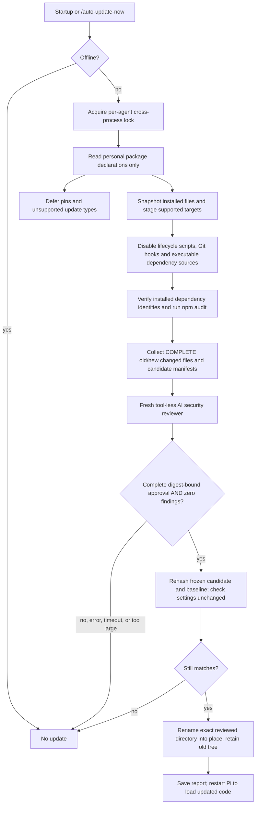

# Pi Auto Update — security-review fork

Fork of [eiei114/pi-auto-update](https://github.com/eiei114/pi-auto-update).
**This fork replaces unconditional updates with a fail-closed review gate.**
It is distributed through Git, not the upstream npm package.

## Features at a glance

- Startup and manual update checks with an independent, tool-less AI code review.
- Complete old/new changed-file review, dependency auditing, and script-free staging.
- Configurable review model via `autoUpdate.reviewModel` or `/auto-update-model`, including Codex OAuth models.
- Updates only after complete approval and zero findings; errors block updates.
- Installs the exact reviewed files, retains backups, and saves review reports.
- Personal npm/GitHub packages on macOS/Linux; Pi-core, project-local, Windows, and unsupported updates are deferred.

An AI review and an advisory scan can miss vulnerabilities. Approval means
**no issue was detected in the supplied changes**, not proof of safety.

## Did the original use an agent?

No. At upstream commit
[`e49977a`](https://github.com/eiei114/pi-auto-update/blob/e49977a698644bd231bcf45e782f006acc65028e/extensions/auto-update.ts),
its entire update policy was:

```mermaid
flowchart TD
    S[session_start] --> R{reason is startup?}
    R -->|no| X[Return]
    R -->|yes| E{Offline or automatic updates disabled?}
    E -->|yes| X
    E -->|no| W{Windows and active intercom runtime?}
    W -->|yes| P[Run pi update]
    W -->|no| U[Run pi update --extensions]
    U --> P
    P --> N[Clear status and report failures/notices]
    M[/auto-update-now] --> W
```

- Each command was awaited, with a 15-minute timeout.
- An extension-update failure did **not** prevent the subsequent Pi update.
- Windows file-lock failures were reported as deferred.
- `/reload`, `/new`, `/resume` and `/fork` did not trigger updates.
- The manual command bypassed the original startup skip checks.
- No model call, diff review, dependency audit, or security approval existed.

## How this fork works



**The reviewer is a separate AI conversation, not an unrestricted child Pi
process.** It uses the configured review model (or the current Pi model by default) and Pi authentication, with
no tools, loaded candidate extensions, skills, project instructions, shell, or
conversation history. It compares behavior against the installed baseline and
checks source, manifests, and changed transitive dependency files.

Every approval must be strict JSON, complete, bound to the candidate's SHA-256
tree digest, and contain **zero findings of any severity**. Suspicious or
unreasonable behavior, security concerns, missing context, malformed output,
model failure, cancellation, failed scans, binary changes and oversized reviews
block that target. There is no force/skip-review path.

No package resolver or installer runs after approval. The exact frozen directory
that was reviewed is promoted, with a rollback attempt on a failed second rename.
The old installation remains in a backup directory.

## Supported scope (important)

| Update type | Policy |
|---|---|
| Personal `npm:name` / `npm:@scope/name` | Stage the managed `<agent-dir>/npm` tree; resolve latest, install from validated lock, audit and review all changed files |
| Personal unpinned GitHub package | Clean default-branch checkout, fast-forward only; stage a fresh HTTPS clone, scan/review source and runtime dependencies |
| Explicit npm versions/tags/ranges or Git refs | Leave the configured pin/ref unchanged |
| Git runtime dependencies | Require a complete npm v2/v3 lockfile; install production dependencies with scripts disabled |
| **Pi itself** | **Deferred; no unchecked `pi update` fallback** |
| **Project-local packages** | **Deferred; this fork does not discover or trust project settings** |
| Windows, legacy global npm layouts, custom npm/pnpm/Bun commands, private registries, other Git hosts, local paths | Deferred/blocked, never passed to the original updater |
| Git with local/ignored files, custom attributes, symlinks or submodules; bundled/workspace dependencies | Manual review required |

Only public `registry.npmjs.org` tarballs with SHA-512 integrity are accepted.
Lockfile versions must match the actual installed package identities. Any
`npm audit` finding (including low/info), audit error or missing audit metadata
blocks installation. A Git package without runtime dependencies needs no npm
install or dependency audit; its source still gets reviewed.

Reviews include **entire before/after changed text files**, not just summaries or
truncated hunks, plus candidate package manifests. Potential credential-file changes (such as `.env` or `auth.json`) are blocked
before sending a review request. This is a conservative filename check, not
comprehensive secret detection. The review limit is 180,000
UTF-8 bytes, with a further conservative model-context limit. Large updates will
often require human review. Unchanged code is not comprehensively audited.

## Install this fork

Requires Pi 1.1 or newer on macOS/Linux, with npm and Git on PATH.

First remove the **original** updater, otherwise it can still perform unchecked
updates independently:

```bash
# Use the matching command for how you installed the original:
pi remove npm:pi-auto-update
# or: pi remove git:github.com/eiei114/pi-auto-update

pi install git:github.com/D3MZ/pi-auto-update
```

Review this fork before trusting it. Installing it opts supported personal
packages into automatic reviews and updates at the next Pi process startup.
A selected, authenticated Pi model is required when changes need review.
For SDK embeddings, set `PI_CODING_AGENT_DIR` explicitly to the SDK agent directory;
this extension uses that variable (or the normal CLI default), not SDK-only overrides.
Review requests incur normal model costs and send package code to that model's
configured provider. No live model request is necessary for the test suite.

```text
/auto-update-now
```

`PI_AUTO_UPDATE=0` disables automatic startup checks; the manual command still
uses the entire security gate. `PI_OFFLINE=1` blocks **both** automatic and manual
network updates. Checks run once at startup, not again for replacement sessions;
concurrent checks are coalesced and use a cross-process lock.

**Restart Pi after an approved update.** The current process may still have old
modules in memory.

## Configure the review model

The review model is independent of your normal chat model. Set it inside Pi:

```text
/auto-update-model openai-codex/gpt-6-luna
```

View the current setting with `/auto-update-model`. Use
`/auto-update-model current` to follow the active chat model again. Commands
validate that an exact chat model exists and its provider has configured
credentials before saving. They do not make an inference request.

Or add this **personal-only** setting to `<agent-dir>/settings.json`
(default `~/.pi/agent/settings.json`), preserving the other settings:

```json
{
  "autoUpdate": {
    "reviewModel": "openai-codex/gpt-6-luna"
  }
}
```

`autoUpdate.reviewModel` takes an exact `provider/model` ID, including nested
model IDs such as `openrouter/anthropic/claude-sonnet-5`. Omit it or set it to
`"current"` to use the active chat model. Unknown, malformed or unauthenticated
selections **block reviews**; they never fall back to another model/provider.
Project settings cannot choose the reviewer. Changing the personal settings
during a review invalidates its approval.

For a Codex/ChatGPT subscription, sign in with `/login` → `openai-codex` and
choose `openai-codex/gpt-6-luna`, the newest Luna chat model currently listed
in Pi. It uses the existing OAuth subscription login, not an OpenRouter or
OpenAI API key. Future model revisions require an explicit configuration change.
The separate `openai` Decisions API classifier with the same model ID is not
used by this extension.

Model selection changes neither `defaultProvider`/`defaultModel` nor the current
chat. Actual review requests consume the selected provider’s usual quota/cost.
Reports record the configured model; session usage entries record the actual model.

## Reports, recovery, and security boundaries

- Reports: `<agent-dir>/auto-update-security/reports/<id>.json`.
- Reports store target status, tree digests, findings, reasons and backup paths,
  not full source prompts. Model usage is recorded as a separate session entry.
- Backups are intentionally retained and are not automatically pruned. Stop all
  Pi processes before restoring a backup or cleaning old backups.
- Promotion journals under each run directory record the original/backup paths.
  A crash between the two renames can leave the live path missing; recover from
  the journal/backup before restarting Pi.
- A crash leaves `<agent-dir>/.auto-update-security.lock`. Verify its PID is no
  longer running before removing it. Locks are never automatically stolen.

This is **not an operating-system sandbox**, a proof of code safety, or a defense
against malicious processes running as the same user. npm, Git, the selected
provider, the current baseline and this extension itself remain trusted.
Prompt injection is mitigated by tool isolation and conservative instructions,
not eliminated.

This gate controls **only this fork's update path**. Pi's initial/missing-package
installation, manual `pi update`/`pi install`, other updaters, and future source
discovery are outside its control. It does not change Pi's core updater. Unknown
vulnerabilities and issues hidden in unchanged code may go undetected.

## Development

```bash
npm ci --ignore-scripts
npm run ci
# Optional real public-registry resolve/install/audit test, still no model inference:
npm run test:network
PI_AUTO_UPDATE=0 pi -e .
```

The tests exercise fail-closed verdicts, findings, audit errors, tampering,
cancellation, locking, source restrictions, real Git staging/hook suppression,
and packed-package loading. The Pi SDK smoke launches real isolated CLI/RPC
processes and verifies a second-process restart/cleanup without real updates.
The opt-in npm integration uses a scripted reviewer; it tests the mechanism,
**not a live model's security judgment**.

Implementation: [entrypoint](extensions/auto-update.ts),
[gate/promotion](extensions/security/gate.ts),
[staging/audit](extensions/security/targets.ts),
[reviewer](extensions/security/review.ts), [snapshots](extensions/security/tree.ts).
Detailed diagrams: [docs/how-it-works.md](docs/how-it-works.md).

MIT. Original author: eiei114. Fork changes: D3MZ.
