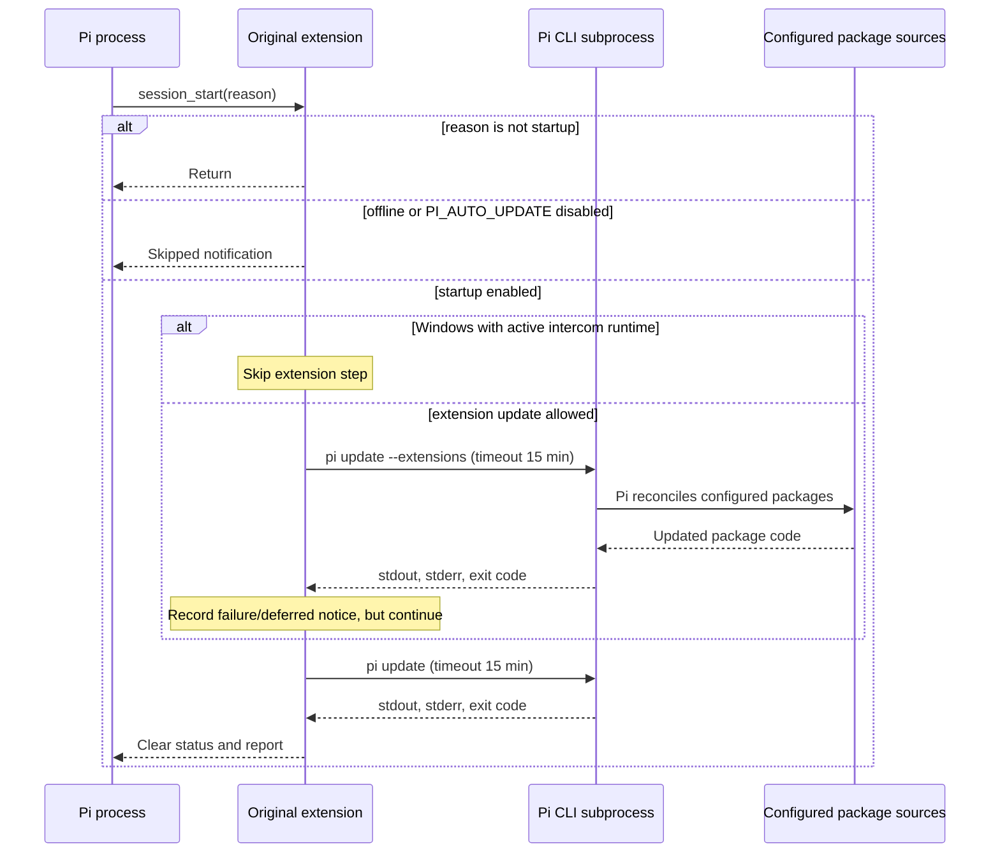

# Execution and trust boundaries

See the [README](../README.md) for original-versus-fork flowcharts and supported scope.

## Original updater, exactly

Source: upstream `e49977a698644bd231bcf45e782f006acc65028e`,
`extensions/auto-update.ts`.



The original `inFlight` promise coalesces concurrent requests inside its runtime.
Its manual command goes directly to the update loop, bypassing startup skip checks.
It never asks an AI to assess either command or its downloaded code.

## Fork: one supported target

```mermaid
sequenceDiagram
    participant Host as Pi / extension
    participant Disk as Installed tree
    participant Stage as Private staging directory
    participant Scan as npm advisory service
    participant Model as Tool-less reviewer
    Host->>Disk: Read personal settings; acquire lock; hash baseline
    Host->>Stage: Stage npm tree or clean GitHub clone
    Note over Stage: No candidate import, build, test or lifecycle execution
    Host->>Stage: Validate integrity-pinned registry lock; npm ci with scripts disabled
    Host->>Stage: Match actual dependency identities to lock
    Host->>Scan: npm audit of staged production lock
    Scan-->>Host: Complete zero-finding result, or block
    Host->>Stage: Freeze candidate separately; hash files and Git metadata
    Host->>Model: New conversation: complete before/after text and manifests
    Note over Model: No tools or parent history; package contents are untrusted data
    Model-->>Host: Strict digest-bound complete approve/block verdict
    alt any finding, incomplete check, error, or unsupported input
        Host->>Stage: Delete candidate; keep baseline
    else complete approval, zero findings
        Host->>Disk: Rehash baseline and recheck settings
        Host->>Stage: Rehash exact frozen artifact
        Host->>Disk: Journal paths; rename baseline to backup
        Host->>Stage: Rename frozen artifact to installed location
        Note over Host,Disk: No re-resolution/download after approval
        Host-->>Host: Persist report; advise restart
    end
```

For a Git target with no runtime dependencies, the install/audit steps are
unnecessary; all changed source/manifests still pass the reviewer.

The candidate digest covers installed file paths, file modes, symlink targets,
and file contents (including dependencies). Git's own generated metadata is
excluded from the model's source diff, but included in the final anti-tampering
check. Git hooks are disabled in commands and in the promoted clone.
Nested `.git` directories inside packages are not omitted from source review.

The byte/UTF-8 limits are hard stops, not truncation. A response cut short at
a token limit cannot approve. Every target is independent; a blocked target
does not grant or revoke approval for another.

## Limits

- An LLM can miss or be misled about a vulnerability. Strict JSON is not a
  semantic security guarantee.
- Advisory services cover reported dependencies, not all vulnerabilities in
  the extension's own code. Code review covers supplied changes, not all
  possible behavior or all unchanged code.
- Scripts disabled during staging may leave build-dependent packages unusable;
  these need manual handling, never an automatic unreviewed build.
- Same-user concurrent writers and process crashes are not an OS isolation
  boundary. The two-rename promotion has a crash window, with journal/backups
  for manual recovery.
- Pi core updates and project packages are intentionally deferred. Wrapping a
  later `pi update` would allow unreviewed bytes to be installed, so this fork
  never does that.
